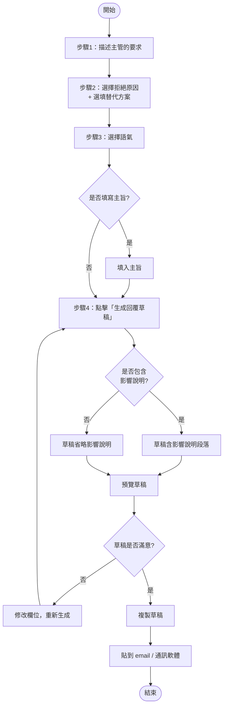

# 🧭 委婉拒絕小工具 — 操作流程圖

下列以 **Mermaid** 語法撰寫，GitHub、VS Code、Typora 等皆可直接渲染顯示。

## 流程圖

## 流程說明

| 步驟 | 動作 | 說明 |
| --- | --- | --- |
| 1 | 描述要求 | 把主管不合理的要求貼進文字框 |
| 2 | 選原因 / 替代 | 選一個主要理由，可選填替代方案 |
| 3 | 選語氣 | 禮貌委婉 / 中性專業 / 明確堅定 |
| 4 | 生成草稿 | 一鍵產出完整回覆草稿 |
| 5 | 開關 & 複製 | 可切換「影響說明」段落，再複製使用 |

## 備註

- 所有資料皆為練習用**假資料**，不會外傳。
- 工具為純前端單一 HTML，無安裝、無後端。
